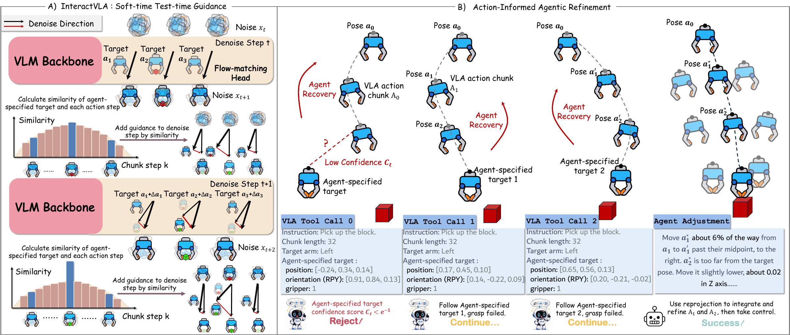

<div align="center">


### Turning VLAs into Interactive Tools for Agentic Robotic Manipulation

**Specify a target. Generate a motion. Inspect and refine.**

[](https://lingwupro.github.io/InteractVLA/)
[](https://openreview.net/forum?id=ytXuX6Zm6J)
[](pyproject.toml)
[](#backends)

[Quick start](#quick-start) · [Method](#method) · [Code map](#code-map) · [Tool API](#tool-api) · [中文技术文档](docs/implementation-guide.zh-CN.md)

</div>

---

**InteractVLA turns a frozen vision–language–action policy into an interactive tool for an agent.** The agent specifies an end-effector target; test-time geometric guidance steers the policy in its native action space. The generated action chunk then becomes feedback for the agent to inspect, revise, and execute.

This repository contains the core runtime, PyTorch and JAX guidance implementations, model adapters, evaluation integrations, and SandboxRSI resources. The [project page](https://lingwupro.github.io/InteractVLA/) includes the method overview, results, and 85 demonstration videos.

## Method

<p align="center">
  
</p>

| Component | What it does | Start reading |
| :--- | :--- | :--- |
| **Geometric guidance** | Differentiates a complete-pose objective through the current action expert while keeping model weights frozen. | [sampling.py](code/interactvla/sampling.py), [geometry.py](code/interactvla/geometry.py) |
| **Soft-time alignment** | Assigns shared arrival-time weights to position, orientation, and gripper error without fixing a target step. | [temporal_objective](code/interactvla/sampling.py), [JAX implementation](code/interactvla/jax_backend.py) |
| **Action-informed refinement** | Exposes action chunks, command poses, history, and camera projections for target revision and motion editing. | [feedback.py](code/interactvla/feedback.py), [runtime.py](code/interactvla/runtime.py) |

The default configuration uses 10 Euler evaluations, with input gradients at generation times `0.5`, `0.6`, and `0.7`. Compatibility checks can return control to the agent before a correction is applied. Compatibility measures target–policy agreement; it is not a task-success probability.

## Quick start

### 1. Install the core package

Use **Python 3.10 or newer**. Model inference additionally needs the environment and hardware required by your chosen upstream model.

```bash
git clone https://github.com/LingwuPro/InteractVLA.git
cd InteractVLA

python -m venv .venv
source .venv/bin/activate
python -m pip install --upgrade pip
python -m pip install -e .
```

### 2. Prepare a checkpoint and adapter

The release includes the interaction code and platform configurations. Supply these deployment-specific inputs separately:

- A compatible pretrained checkpoint and its complete upstream model implementation.
- An adapter manifest describing native action channels, normalization, geometry, gripper mapping, and control timing.
- Simulator assets or a robot controller and its calibration, when executing actions.

The manifest must agree with the checkpoint and selected platform configuration. See the [adapter specification](docs/implementation-guide.zh-CN.md#adapter-manifest) for required fields and coordinate conventions.

### 3. Start the tool server

<a id="backends"></a>
**StarVLA / PyTorch**

Install the full StarVLA model dependencies matching your checkpoint, then run:

```bash
source setup_env.sh libero

python -m interactvla.cli \
  --backend starvla \
  --checkpoint /path/to/checkpoint \
  --manifest /path/to/adapter.json \
  --config code/mr-starvla/examples/KeypointFlow/libero.json
```

**π0.5 / OpenPI / JAX**

Install a checkpoint-compatible OpenPI, JAX, and Flax environment. The optional extra supplies the package's JAX dependencies; it does not install OpenPI or model weights.

```bash
python -m pip install -e '.[pi05]'
source setup_env.sh libero

python -m interactvla.cli \
  --backend pi05 \
  --openpi-config YOUR_OPENPI_CONFIG \
  --checkpoint /path/to/checkpoint \
  --manifest /path/to/adapter.json \
  --config code/mr-starvla/examples/KeypointFlow/libero.json
```

The server listens on `127.0.0.1:18200` by default. Add `--controller-factory package.module:factory` to connect an executor. Without an executor, the service can generate and inspect proposals from supplied observations.

### Platform configurations

| Configuration | Generated chunk | Maximum executed prefix | Control rate |
| :--- | ---: | ---: | ---: |
| [LIBERO](code/mr-starvla/examples/KeypointFlow/libero.json) | 10 | 10 | 20 Hz |
| [RoboDojo](code/mr-starvla/examples/KeypointFlow/robodojo.json) | 50 | 16 | 20 Hz |
| [RoboCasa365](code/mr-starvla/examples/KeypointFlow/robocasa365.json) | 50 | 16 | 20 Hz |
| [Dexmal](code/mr-starvla/examples/KeypointFlow/dexmal.json) | 32 | 8 | 10 Hz |

These are configuration defaults. Running an environment also requires its dependencies, assets, and controller integration.

## Tool API

The runtime exposes a versioned JSON interface for an observe–propose–inspect–execute loop.

| Tool | Purpose |
| :--- | :--- |
| `observe` | Read a controller observation or provide one in inference-only mode. |
| `propose` / `guide` | Generate a native or geometrically guided action chunk. |
| `inspect` | Retrieve the full chunk, executed prefix, continuation, projections, and diagnostics. |
| `edit` | Create a new proposal with bounded local pose edits. |
| `backproject` | Recover a 3D point from a calibrated RGB-D view. |
| `execute` | Explicitly execute an accepted proposal prefix. |
| `stop` | Cancel subsequent commands and invalidate pending proposals. |
| `memory` | Store or retrieve versioned task records. |

Requests use `schema_version: "interactvla/1.0"`, a unique `request_id`, a `tool`, and `arguments`. State-dependent operations also carry `observation_id` and `state_version`. Repeating an identical request returns its cached result; reusing its ID with different arguments is rejected.

A controller implements `observe()`, `execute(command, expected_state_version=...)`, and `stop()`. Execution responses include status, an incremented state version, and measured state. See the [complete protocol](docs/implementation-guide.zh-CN.md#工具协议) and [runtime tests](tests/test_interactvla.py) for details.

## Code map

```text
InteractVLA/
├── code/
│   ├── interactvla/             # Public package and tool server
│   │   ├── sampling.py          # PyTorch guidance and soft-time objective
│   │   ├── geometry.py          # Native actions → command poses
│   │   ├── jax_backend.py       # JAX geometry and sampling
│   │   ├── models.py            # StarVLA and OpenPI adapters
│   │   ├── feedback.py          # Projections and motion edits
│   │   ├── runtime.py           # Tool protocol and execution lifecycle
│   │   └── cli.py               # Server entry point
│   ├── mr-starvla/              # Configs and evaluation integrations
│   └── work_dirs/              # Additional environment integrations
├── skills/SandboxRSI/           # Sandbox and recovery resources
├── tests/                      # Guidance, geometry, and runtime tests
├── docs/                       # Detailed implementation guide
├── pyproject.toml
└── setup_env.sh
```

Useful entry points: [LIBERO evaluation](code/mr-starvla/work_dirs/keypoint_flow/evaluation), [RoboCasa integration](code/work_dirs/robocasa365_agent), and [SandboxRSI](skills/SandboxRSI).

## Tests

```bash
python -m pip install -e '.[test]'
python -m pytest tests -q
```

The included tests cover temporal gradients, PyTorch/JAX consistency, action masks, gripper geometry, compatibility checks, execution versions, and local edits. They use synthetic fixtures; checkpoint inference, full simulator evaluations, and physical robot execution require their respective environments.

## Citation

```bibtex
@misc{zhao2026interactvla,
  title = {Turning VLAs into Interactive Tools for Agentic Robotic Manipulation},
  author = {Chen Zhao and Zipeng Ye and Shifeng Bao and Yihan Lin and
            Haitao Shen and Yining Luo and Yuchen Xie and Jing Zhang},
  year = {2026},
  url = {https://openreview.net/forum?id=ytXuX6Zm6J}
}
```

## Acknowledgments

InteractVLA builds on pretrained VLA models and robotics environments. Bundled third-party notices are preserved in their original locations, including the [StarVLA license](code/mr-starvla/LICENSE). Upstream model weights, implementations, and environment assets remain subject to their respective terms.

<div align="center">

**[Explore the project →](https://lingwupro.github.io/InteractVLA/)**

Source lives on `main` · The project website is maintained on [`gh-pages`](https://github.com/LingwuPro/InteractVLA/tree/gh-pages)

</div>
